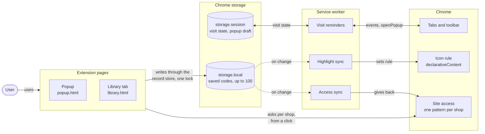

# PromoBase

A Chrome extension for saving promo codes - especially the ones you pick up from creators and online content - and getting reminded of them when you visit the merchant's site.

**Status:** version 0.1.0, the first release, is [on the Chrome Web Store](https://chromewebstore.google.com/detail/promobase/elmfhcdfmbgahialibbopcmjbbknhbgj). It can also be built and loaded from source (see [Development](#development)).

## What it does (first release)

- Save a promo code with an optional merchant URL, note, start date, or expiry date.
- On a site you have codes for, the PromoBase toolbar icon turns yellow, and the popup lists that site's codes. This needs no access to the site.
- Browse, search, edit and delete saved codes in a local library.
- Export every saved code to a JSON file from the library, and import such a file back, for example on another computer.
- Opt in per merchant to a reminder: when you visit that merchant's site, PromoBase opens by itself, once per visit, with the matching codes. Chrome asks for access to that site when you switch it on.

## Supported browser

Google Chrome desktop, version 127 or later (Manifest V3).

## Your data

- Records are stored locally in the browser profile (`chrome.storage.local`). There is no account and no server in the first release.
- Nothing is uploaded: no promo codes, notes, or visited URLs leave your machine.
- Site access is optional and requested per merchant, only for merchants you enable reminders for.
- Local-only storage means records are lost if the extension is removed or the browser profile is deleted. Export from the library keeps a copy on your computer, and Import brings it back.

The full [privacy policy](PRIVACY.md) says what PromoBase keeps and looks at. The Chrome Web Store listing text and images are in [`store/`](store/listing.md).

The product requirements (PRD v0.4) and the decisions behind them are in [`docs/`](docs/README.md).

## Architecture



Solid arrows are writes or calls, dashed ones are events.

- **Pages.** The popup and the library are React pages. Every change to saved codes goes through `src/data/record-store.ts`, which holds one lock for the whole read-change-write; nothing else writes to `storage.local`.
- **Service worker.** Chrome wakes it for a change to the saved codes and for tab, window, install and startup events. It keeps the toolbar icon rule and the site access PromoBase holds in step with the saved shops, and opens the popup when you visit a shop with reminders on. It loads neither React nor the Public Suffix List.
- **Chrome.** The icon turns yellow through a rule Chrome runs itself, so it needs no access to the site. Site access is asked for only from a click in a page, as `*://*.<shop>/*` for each shop with reminders on, and given back once no shop needs it. PromoBase sees a shop's address, never the content of its pages, and makes no network requests.

Inside each part, the code is layered the same way: `src/ui` works out what a page shows, `src/data` reads and writes under locks, `src/domain` holds the pure logic, and only `src/platform` calls Chrome (see the table under [Development](#development)).

## Development

Requirements: Node.js 22.12 or later, npm, and Google Chrome 127 or later.

```sh
npm install
npm run build    # production build into dist/
npm run dev      # rebuild on every change
```

Load the build in Chrome:

1. Open `chrome://extensions` and turn on **Developer mode**.
2. Choose **Load unpacked** and select the `dist/` folder.
3. Pin PromoBase from the extensions menu and click its toolbar icon.

After a rebuild, reopening the popup is enough to see popup changes. Changes to the manifest or the service worker need the reload button on the PromoBase card in `chrome://extensions`.

Checks:

```sh
npm run check    # lint, type check, format check, unit tests, build
npm test         # unit tests only
npm run test:browser   # the built extension in a real Chrome; see tests/browser/README.md
```

The icons and the store tile are drawn by a script, so they carry no metadata (Python 3.11 or later):

```sh
python3 -m pip install -r tools/requirements.txt
python3 tools/draw-icons.py
```

How to contribute, including the rules for changing stored data: [CONTRIBUTING.md](CONTRIBUTING.md).

How a version is released to the Chrome Web Store: [RELEASING.md](RELEASING.md).

Stack: TypeScript, Manifest V3, React with Vite.

| Path             | Contents                                                  |
| ---------------- | --------------------------------------------------------- |
| `src/domain`     | Types and pure logic, no Chrome APIs                      |
| `src/platform`   | Thin adapters around Chrome APIs                          |
| `src/data`       | Reading stored state and changing saved records           |
| `src/ui`         | Code shared by the pages                                  |
| `src/popup`      | Toolbar popup                                             |
| `src/library`    | Full-page library                                         |
| `src/background` | Service worker                                            |
| `public`         | Manifest and icons, copied to `dist/` unchanged           |
| `tests`          | Checks that span the project, and helpers shared by tests |

## Reporting issues

Open an issue in this repository. Do not include real promo codes or personal data in reports - use made-up examples.

## License

[MIT](LICENSE)
